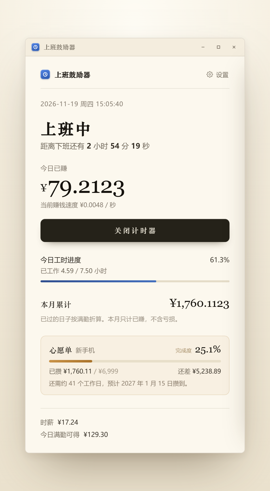
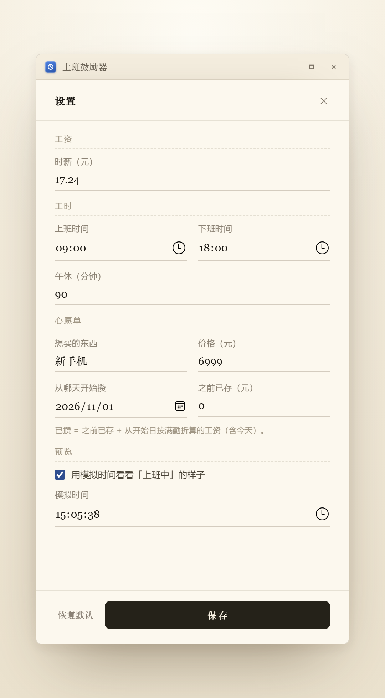

# 上班鼓励器 · Work Encourager

> 把上班的每一秒，换算成看得见的钱。


一个单文件的桌面风格小工具。它把你今天的工时实时换算成钱：今天赚了多少、距离下班还有多久、这个月攒了多少，以及离想买的那件东西还有多远。

起因是看到一张桌面应用截图，觉得「时间正在变成钱」这件事如果能一秒一秒地发生，比任何鸡汤都提神——于是把它真的做了出来。

<p align="center"></p>

## 功能

- **实时到账**：今日已赚保留四位小数，每 150ms 刷新一次，最后一位数字一直在跳
- **下班倒计时**：时 / 分 / 秒，自动区分「还没上班」「上班中」「已下班」「休息日」
- **今日工时进度**：已工作 x.xx / 7.50 小时，配蓝色进度条
- **本月累计**：本月已过的工作日按满勤折算，再加上今天已赚的部分
- **心愿单**：金色进度条 + 完成度 + 还差多少钱 + 还需多少个工作日 + 预计哪天攒到，攒够时数字转为金色
- **计时器开关**：暂停后金额冻结并变淡，恢复后继续累加（暂停的那段时间不会被补算）
- **可改配置**：时薪、上下班时间、午休、心愿物品与起算日期，改动保存在本地
- **窗口按钮**：最小化 / 最大化 / 关闭都能点，关闭后还能重新打开
- **完全离线**：零依赖、零网络请求，连字体都用系统自带的

## 快速开始

直接双击 `上班鼓励器.html` 就能用（也可以把文件拖进浏览器，或者起个本地服务 `python3 -m http.server 8000` 后访问 `localhost:8000`）。

第一次打开记得点右上角「设置」，把时薪和上下班时间改成你自己的——默认值是照着参考截图里的 17.24 元/时、09:00–18:00 填的，大概率不是你的。

整个项目就这么点东西：

```
.
├── 上班鼓励器.html   # 全部代码都在这个文件里
├── assets/          # README 用的截图
├── README.md
└── LICENSE
```

## 设置项

| 项目        | 说明             | 默认值               |
| --------- | -------------- | ----------------- |
| 时薪        | 元 / 小时         | `17.24`           |
| 上班 / 下班时间 | 24 小时制         | `09:00` / `18:00` |
| 午休        | 分钟，从总工时里扣掉     | `90`              |
| 想买的东西     | 显示在心愿单标题旁      | `新手机`             |
| 价格        | 心愿单目标金额        | `6999`            |
| 从哪天开始攒    | 用来折算过去已经攒下的工资  | 本月 1 号            |
| 之前已存      | 已经在攒的钱，会直接加进进度 | `0`               |

<p align="center"></p>

## 计算方式

```
日薪        = (下班时间 − 上班时间 − 午休) × 时薪
每秒收入    = 时薪 ÷ 3600
今日已赚    = 已工作秒数 × 每秒收入
本月累计    = 本月已过的工作日 × 日薪 + 今日已赚
心愿已攒    = 之前已存 + 从开始日到今天之前的工作日 × 日薪 + 今日已赚
还差        = 心愿价格 − 心愿已攒
还需工作日  = ⌈(还差 − 今天剩余还能赚的钱) ÷ 日薪⌉
预计达成日  = 从今天往后数「还需工作日」个工作日（跳过周六日）
```

以默认值为例：7.5 小时 × 17.24 元 = 日薪 **129.30** 元，每秒 **0.0048** 元；从零开始攒一个 6999 元的目标，大约需要 **54 个工作日**（两个半月左右）。

**几条边界说明**

- 工作日按周一到周五计算，不识别法定节假日与调休
- 午休默认从 12:00 开始，若放不下会自动在上下班区间内前移
- 不支持跨天夜班，下班时间早于上班时间时按 1 分钟处理
- 所有金额都是按满勤折算的估算值，不是工资条，别拿去和财务对账

## 小技巧

- 想在大白天预览「上班中」的样子：在地址后面加 `?demo=15:05:38`
- 也可以勾选设置里的「用模拟时间看看『上班中』的样子」，看完记得取消
- 数据只存在浏览器的 localStorage（键名 `shangban-guliqi-v2`），换浏览器、清缓存或无痕模式都会丢

## 隐私

没有任何网络请求。工资、工时、心愿单全部留在你的浏览器本地，不会上传到任何地方。

## 技术说明

单文件 HTML + 原生 CSS/JavaScript，无构建步骤、无第三方依赖。字体使用系统栈（华文中宋 / 宋体 + Georgia），配色是奶油纸感 + 墨色 + 一点蓝。窗口高度低于 820px 时会自动切换成紧凑排版，768p 的笔记本屏也能一屏放下。

界面文案为简体中文。在 Chrome、Edge、Safari 的近年版本上都能直接跑，不需要服务器，也不需要联网。

## Roadmap

- [ ] 法定节假日与调休识别
- [ ] 打包成 Electron / Tauri 桌面小组件，可置顶悬浮在桌面角落
- [ ] 多个心愿单并列比较
- [ ] 月度、年度赚取记录

## License

[MIT](LICENSE)
